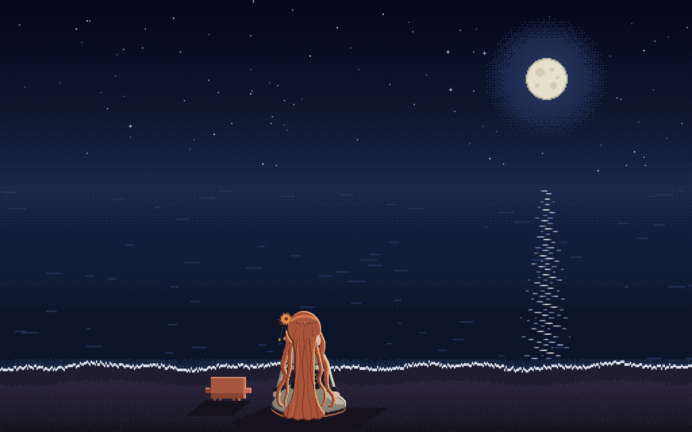

# Moonlit Beach 月光海滩

月光下的海边，Claude 娘和 Clawd 坐在沙滩上看海。一张会动的像素风终端背景（2560×1600 GIF，24 帧循环）：海浪涨落、月光在海面闪烁、星星眨眼、头发随风轻摆。



另有逆光剪影版 [`beach_C.gif`](beach_C.gif)。

整张图都由代码画出来，没有用任何现成图片：

- `scene.py`：背景（天空、月亮、海、海浪、沙滩），512×320 像素画布放大 5 倍
- `chars_hd.py`：人物图层。轮廓用平滑样条曲线，按 2.5 倍精度绘制；朝月亮那一侧的边缘自动勾出月光亮边

## 自己生成

需要 Python 3、Pillow 和 NumPy：

```
pip install pillow numpy
python scene.py gif B        # 上色版 -> beach_B.gif
python scene.py gif C        # 剪影版 -> beach_C.gif
python scene.py preview B    # 只出第 0 帧静态图
```

## 设成 Windows Terminal 背景

在 `settings.json` 的 `profiles.defaults`（所有标签页），或某个 profile 里加：

```json
"backgroundImage": "C:\\path\\to\\beach_B.gif",
"backgroundImageStretchMode": "uniformToFill",
"backgroundImageAlignment": "bottom",
"backgroundImageOpacity": 0.75,
"background": "#05081A"
```

- `alignment: bottom`：窗口比例和图片不同时，裁掉的是上方的天空，人物和海岸会保留下来。
- Windows Terminal 按文件路径缓存背景图。重新生成后要换一个文件名，否则显示的还是旧图。

## 授权

**代码**（`*.py`）使用 [MIT 协议](LICENSE)。

**画面中的角色不适用 MIT 协议**：

- **Claude 娘**的形象设定（橙色长发、菊花头饰、橙黑米白配色）来自中文社区画师 ZipZipPipe 的同人设定，参考了 [ai-chan-sheets](https://github.com/lmy414/ai-chan-sheets) 整理的设定图。设定版权归原作者。
- **Clawd** 是 Anthropic 为 Claude Code 设计的吉祥物。

生成的 GIF 和图片仅供个人、非商业使用。本项目是非官方的同人作品，与 Anthropic 无关。
